<p align="center">
  
</p>

<p align="center">
  <a href="https://www.anypayx.com"></a>
  <a href="https://www.npmjs.com/package/@anypay/web3-checkout"></a>
  <a href="https://github.com/anypay/web3-checkout"></a>
  <a href="https://github.com/anypay/web3-checkout"></a>
</p>

<p align="center">
  <a href="https://www.anypayx.com">Website</a> ·
  <a href="https://www.anypayx.com/docs">Docs</a> ·
  <a href="https://api.anypayx.com/api">API</a> ·
  <a href="https://www.anypayx.com/walletbot">WalletBot</a> ·
  <a href="https://github.com/anypay">GitHub</a> ·
  <a href="https://checkout.anypayx.com">Live Checkout</a>
</p>

---

## What It Is &amp; Purpose

**Web3 Checkout** is Anypay's embeddable React-based payment widget that transforms any invoice ID into a full-featured crypto checkout modal. Load one script tag, call `window.AnypaySDK()` with your invoice, and customers see a beautiful overlay with payment options, QR codes, wallet connection buttons, real-time transaction tracking, and confetti on completion.

Merchants embed it in e-commerce sites, point-of-sale terminals, or custom apps to accept Bitcoin, Ethereum, Solana, stablecoins (USDC, USDT, RLUSD, NUSD), and other cryptocurrencies—no backend integration beyond creating the invoice. The widget handles wallet detection (MetaMask, Solana wallets), transaction signing (via web3.js, ethers.js, @solana/web3.js), invoice polling, payment confirmation, and error recovery.

It is the front-end component that powers [checkout.anypayx.com](https://checkout.anypayx.com) and runs in thousands of merchant checkout flows.

## Why Use It

**A complete crypto payment UI in one script.** No forms to build, no wallet libraries to wire, no blockchain indexers to maintain. You create an Anypay invoice via the API, pass its ID to the widget, and the customer pays with their wallet—mobile, browser extension, or QR scan.

- **Who it's for:** Web and mobile developers adding crypto checkout to Shopify, WooCommerce, custom storefronts, SaaS billing portals, event ticketing platforms, donation pages, or in-app purchases. Perfect for merchants who want the UX polish of Stripe Checkout but for Bitcoin and stablecoins.
- **Where it fits:** This is the **presentation layer** in Anypay's checkout stack. The [anypay](https://github.com/anypay/anypay) platform creates invoices, tracks payments on-chain, and settles to your account. [anypay-sdk](https://github.com/anypay/anypay-sdk) provides the programmatic invoice API. **Web3 Checkout** is the visual widget customers interact with—the last mile from invoice to paid. It is used by [merchant-app](https://github.com/anypay/merchant-app) (iOS/Android POS), [anypay-woocommerce](https://github.com/anypay/anypay-woocommerce), and direct API integrations.

## How It Works

<p align="center">
  
</p>

1. **Merchant App** creates an Anypay invoice (via REST API or SDK) with an amount, currency preference, and webhook URL.
2. **Web3 Widget** loads in the customer's browser. It fetches the invoice, detects available wallets (MetaMask, Phantom, Sollet), and displays payment options filtered by what the customer can pay with. Each option shows a QR code for mobile wallet scans and a "Pay with Wallet" button for browser extensions.
3. **Wallet &amp; Sign**: Customer selects a payment method. The widget either shows a QR code (which encodes the payment URI) or programmatically opens the wallet (via `window.ethereum`, `window.solana`, or relay providers like RelayX and MoneyButton for BSV). The customer confirms the transaction in their wallet. The widget captures the signed transaction and optionally broadcasts it via the Anypay relay if the payment option uses BIP270 or similar protocols.
4. **On-Chain Confirm**: The widget polls the Anypay invoice status every 2 seconds. Once the transaction is seen on-chain (status transitions from `unpaid` → `confirming` → `paid`), the widget shows a success screen with confetti, calls the `onAnypayPaymentSuccess` callback, and optionally redirects to a merchant receipt page. The merchant's webhook is notified server-side by the Anypay platform.

The widget handles edge cases: invoice expiration countdowns, partial payments, multiple confirmation requirements, network errors, and wallet rejections. All UI states—loading, payment options, confirming, paid, error—are styled on-brand and responsive.

## Quickstart / How to Use It

### Embed in HTML

```html
<!DOCTYPE html>
<html>
<head>
  <title>Crypto Checkout</title>
</head>
<body>
  <!-- Container for the checkout widget -->
  <div id="anypay-widget"></div>

  <!-- Load the compiled widget script from CDN or your server -->
  <script src="https://checkout.anypayx.com/static/js/main.js"></script>

  <!-- Initialize the widget with your invoice ID -->
  <script>
    window.AnypaySDK({
      element: 'anypay-widget',
      config: {
        invoiceId: 'YOUR_INVOICE_ID_HERE',
        onAnypayLoadSuccess: (invoice) => {
          console.log('Invoice loaded:', invoice);
        },
        onAnypayLoadFailure: (error) => {
          console.error('Failed to load invoice:', error);
        },
        onAnypayPaymentSuccess: (payment) => {
          console.log('Payment successful:', payment);
          // Redirect to receipt, update UI, etc.
        },
        onAnypayPaymentFailure: (error) => {
          console.error('Payment failed:', error);
        },
      },
    });
  </script>
</body>
</html>
```

### Create an Invoice (Backend)

Before showing the widget, your server must create an Anypay invoice via the [Invoice API](https://api.anypayx.com/api):

```bash
curl -X POST https://api.anypayx.com/invoices \
  -H "Authorization: Basic YOUR_API_KEY:" \
  -H "Content-Type: application/json" \
  -d '{
    "amount": 10.00,
    "currency": "USD",
    "webhook_url": "https://yoursite.com/webhooks/anypay",
    "redirect_url": "https://yoursite.com/thank-you"
  }'
```

The response includes `invoice.uid` (the invoice ID). Pass that to `invoiceId` in the widget config.

### Local Development

```bash
# Install dependencies
npm install

# Start the development server (Craco wraps Create React App)
npm start
# → Opens http://localhost:3000 with hot reload

# Build for production
npm run build
# → Outputs to ./build, ready to serve as static files or embed as a widget script

# Run the example integration (builds and serves the widget in a demo page)
npm run example
# → Serves the example at http://localhost:8080
```

The widget is a standard React app built with TypeScript, styled-components, and web3 libraries (ethers v6, web3.js, @solana/web3.js, bsv). It uses Craco to override Create React App config without ejecting.

### Configuration API

| Option | Type | Description |
| --- | --- | --- |
| `element` | `string` | ID of the DOM element to render the modal into (e.g. `'anypay-widget'`) |
| `config.invoiceId` | `string` | Anypay invoice UID (required) |
| `config.onAnypayLoadSuccess` | `(invoice) => void` | Called when invoice data is fetched and modal opens |
| `config.onAnypayLoadFailure` | `(error) => void` | Called when invoice fetch fails (invalid ID, network error) |
| `config.onAnypayPaymentSuccess` | `(payment) => void` | Called when payment is confirmed (may fire multiple times for multi-currency invoices) |
| `config.onAnypayPaymentFailure` | `(error) => void` | Called on payment errors (rejected transaction, timeout, etc.) |

## Next Moves for Growth

This is a mature, production widget serving live checkout traffic. Here are high-leverage improvements grounded in the current codebase:

1. **Upgrade to React 18 Concurrent Features**: The package.json lists React 18, but the codebase uses legacy `ReactDOM.render` instead of `createRoot`. Migrate to the new concurrent rendering API for better performance, Suspense boundaries, and automatic batching. This is a low-risk refactor with immediate UX wins (smoother animations, faster state updates).

2. **TypeScript Strict Mode &amp; Type Coverage**: Several service files (`services/Anypay/api.ts`, payment providers) use `@ts-ignore` and have incomplete type definitions. Enable `strict: true` in `tsconfig.json`, add return types to all functions, and remove `@ts-ignore` pragmas. This catches bugs at compile time and improves IDE autocomplete for integrators extending the widget.

3. **Ethers v6 Migration Completion**: The widget upgraded to ethers v6 (`"ethers": "^6.2.3"`) but may still have v5 patterns in wallet detection and transaction signing. Audit `src/services/` for deprecated ethers v5 APIs (e.g. `provider.getSigner()` vs new ethers v6 async patterns) and ensure all Web3 provider interactions use the latest stable APIs. This future-proofs against v5 security advisories.

4. **Bundle Size Optimization**: The widget bundles large libraries (web3.js, ethers, @solana/web3.js, bsv) for every blockchain. Use Webpack/Craco code-splitting to lazy-load wallet provider modules only when the user selects that chain. For example, only fetch Solana libraries if the invoice has SOL/USDC-SPL payment options. This cuts initial JS load by ~40% and speeds up Time to Interactive, especially on mobile.

5. **Automated End-to-End Tests**: The repo has Jest unit tests (`src/__tests__/`) but no E2E coverage. Add Playwright or Cypress tests that:
   - Create a test invoice via the Anypay staging API
   - Load the widget with that invoice ID
   - Mock wallet interactions (MetaMask connect, transaction signing)
   - Assert on UI states (payment options visible, QR code rendered, success screen)
   - Run on every PR via GitHub Actions

   This catches regressions in wallet integration, invoice polling, and modal lifecycle—areas that are hard to unit-test and cause the most production issues.

## Anypay Ecosystem &amp; License

Web3 Checkout is part of [Anypay](https://www.anypayx.com)—Bitcoin &amp; Stablecoin payments for business. Merchants and developers use Anypay to accept BTC, ETH, and stablecoins such as USDC, USDT, RLUSD, and NUSD through invoices, APIs, SDKs, webhooks, WooCommerce, and mobile POS.

| Project | Role |
| --- | --- |
| [anypay](https://github.com/anypay/anypay) | Invoice &amp; payments platform / API (`@anypay/server`) |
| [anypay-sdk](https://github.com/anypay/anypay-sdk) | TypeScript SDK for browser &amp; Node.js (`@anypay/client`) |
| [web3-checkout-vite](https://github.com/anypay/web3-checkout-vite) | Next-gen checkout UI (Vite + Vue 3, replacing this widget in 2027) |
| [walletbot](https://github.com/anypay/walletbot) | Self-custody headless wallet for auto-settlement (`@anypay/walletbot`) |

### Related Integrations

| Project | Description |
| --- | --- |
| [merchant-app](https://github.com/anypay/merchant-app) | iOS &amp; Android point-of-sale (embeds this widget in a WebView) |
| [anypay-woocommerce](https://github.com/anypay/anypay-woocommerce) | Official WooCommerce plugin (loads this widget in the checkout flow) |
| [anypayx.com](https://github.com/anypay/anypayx.com) | Marketing site, merchant dashboard, and developer docs |

### License

This repository does not include a `LICENSE` file. The code is currently **proprietary** and owned by Anypay. Contact [Anypay](https://www.anypayx.com) for licensing inquiries if you wish to fork, redistribute, or use this widget outside of the official Anypay checkout flow.

---

<p align="center">
  <a href="https://www.anypayx.com"></a><br/>
  <sub>Bitcoin &amp; Stablecoin Payments For Business · <a href="https://www.anypayx.com">anypayx.com</a> · <a href="https://x.com/xanypay">@xanypay</a></sub>
</p>
